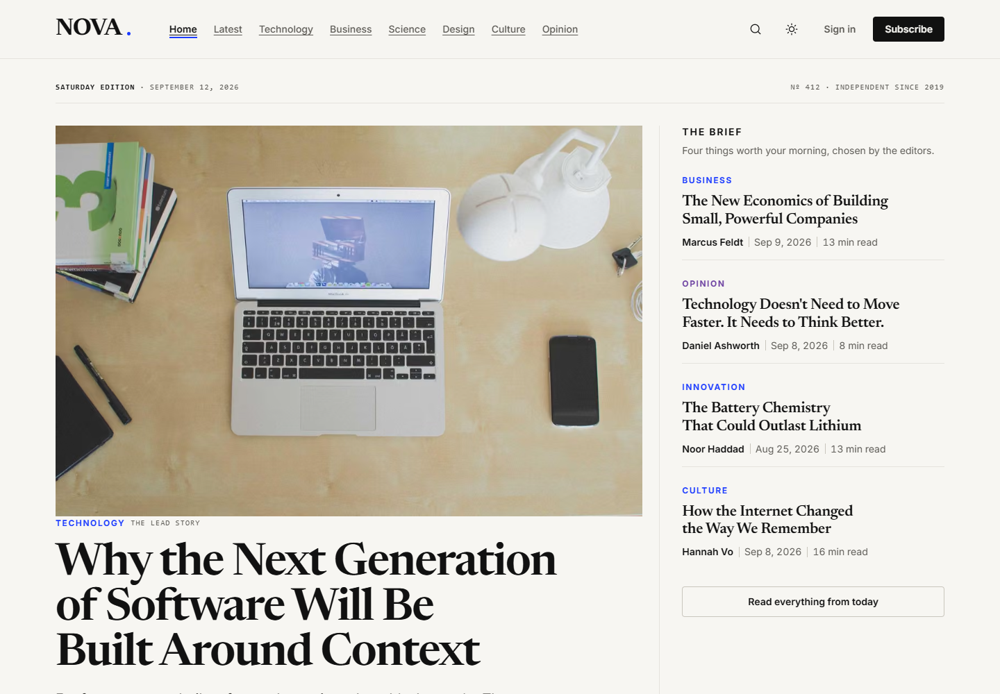
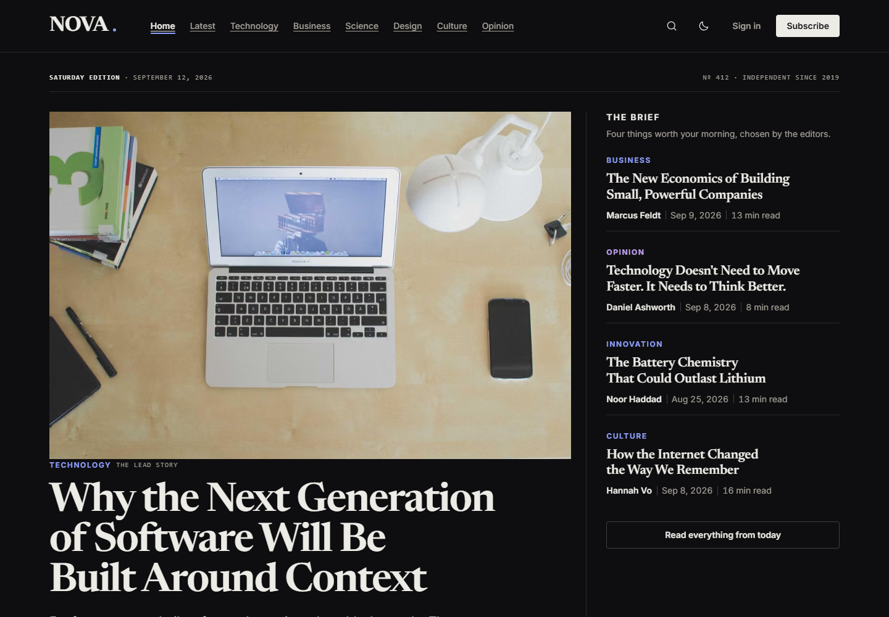
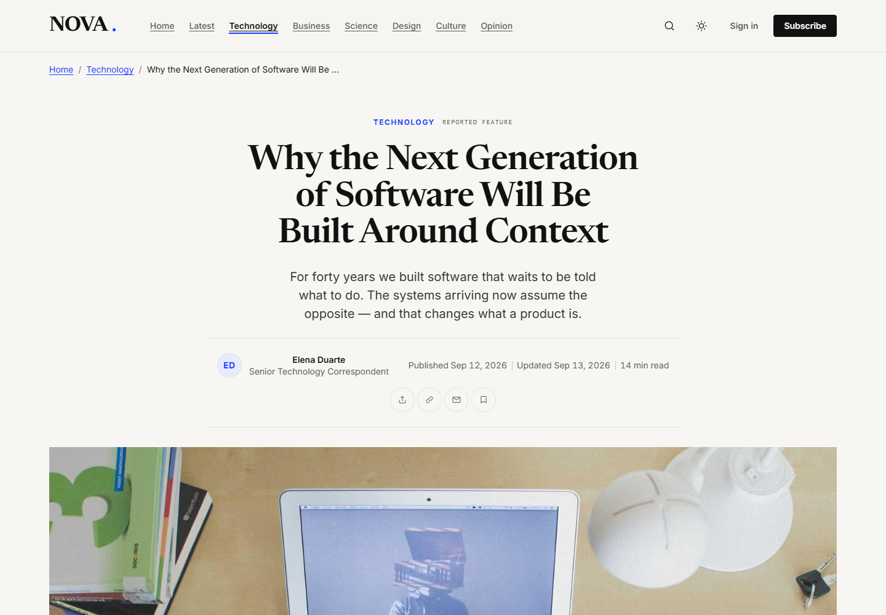
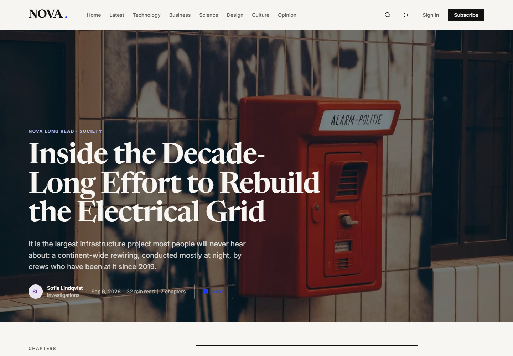
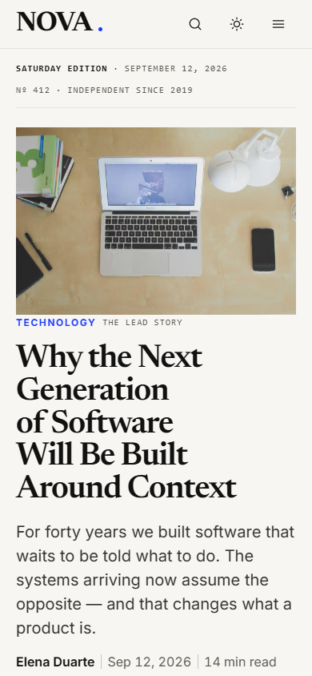
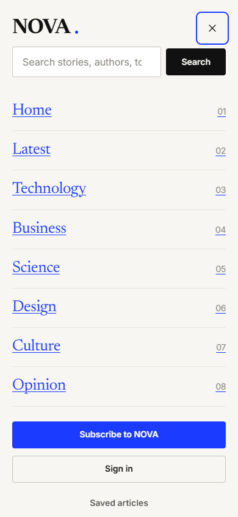
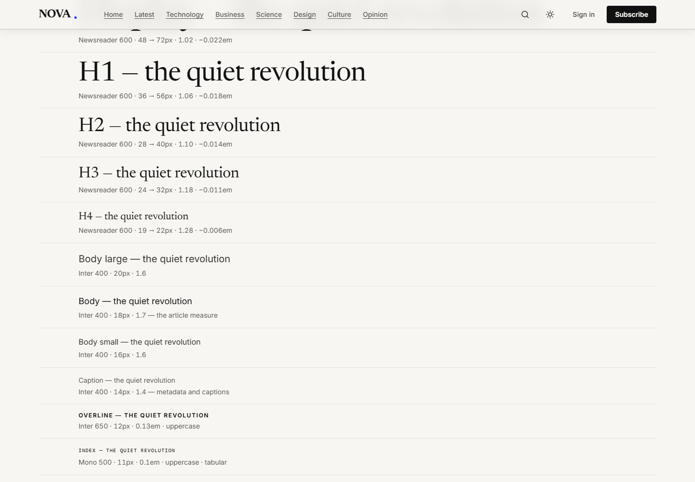

# NOVA — a news and long-form publication

NOVA is an editorial news site: a front page, article and long-read layouts, section and topic pages, author pages,
search, saved reading, accounts, a newsletter and a subscription page. It is built as a Next.js front end
(`web/`) on top of a TypeScript Express + MongoDB API (`backend/`) with a staff back office for writing and publishing,
and its interface is a pixel-faithful implementation of a hand-designed editorial design system (`blog-refrence/`).

| Light | Dark |
|---|---|
|  |  |

| Article | Long read |
|---|---|
|  |  |

| Phone | Phone menu | Design system |
|---|---|---|
|  |  |  |

## What is in the repository

| folder | what it is |
|---|---|
| `web/` | **The site.** Next.js 16 (App Router) + React 19 + TypeScript, styled with Tailwind CSS v4 and shadcn/ui. |
| `backend/` | **The API.** TypeScript, Express 5, MongoDB (Mongoose), zod. Accounts and sessions, the public content API, and the editorial back-office API. Its own README documents every endpoint. |
| `blog-refrence/` | The design source: 15 static HTML screens, the design system page and its stylesheet. The site is built to match it. |

## How the front end works

- **One source of truth for design.** Every colour, type size, spacing step, radius, shadow and animation lives as a
  token in a single `@theme` block in `web/src/app/globals.css`; Tailwind turns those tokens into utilities. There is
  no other stylesheet, no CSS Modules and no hard-coded colour or pixel value in a component.
- **Component-driven.** Components are layered `ui/` (shadcn + Radix: button, dialog, menu, tabs, tooltip, toast)
  → `primitives/` (layout, type, badge, form, icon) → `patterns/` (section heads, ledger, article card, comments,
  newsletter band …) → `layout/` (header, footer) → pages. A section that appears on two pages is one component with
  props, never two copies.
- **Pages are composition.** Each route under `web/src/app/(site)/` fetches data and arranges patterns. Server
  Components by default; `"use client"` only on the small interactive leaves (menus, forms, filters).
- **One data layer, the real API.** Articles, authors, sections and topics are read on the server through
  `web/src/services/content.ts` from the `backend/` API (cached for a minute, tagged so publishing refreshes exactly what
  changed). Accounts, comments, saved articles and follows talk to the same API from the browser, through the site's own
  `/api/*` so the session cookies stay same-origin. `web/src/data/mock` is the original design content, kept only as the
  source `backend/seed` was exported from.
- **English first, Persian ready.** The base edition is English / LTR. Copy lives in typed dictionaries
  (`web/src/i18n`), URLs in one route map, and logical CSS utilities plus an `fa:` variant make a right-to-left
  Persian edition work without a second set of components.
- **Light and dark.** The theme is an attribute on `<html>`, set before first paint so there is no flash.
- **Accessible by default.** Focus rings, 44px targets, labelled icon buttons, skip link, reduced-motion support.

### The back office

Staff sign in at `/admin` (writer, editor or admin accounts; the API enforces the role on every call). It is a client app
over the same API, built from the same components as the site:

- **Articles** — filter by status, search titles, and open any piece.
- **Block editor** — a piece is a list of typed blocks (paragraph, headings, list, figure, pull quote, related stories,
  chapter, image band, bar chart, note, timeline), each edited with a generated form and reorderable.
- **Live preview** — drawn by the *same* `ArticleHead`, `Frame` and `ArticleBody` the public page uses, fed from unsaved
  state, beside the form on wide screens and as a tab on narrow ones.
- **Workflow** — draft → scheduled / published → archived, with a version history you can restore from, protection
  against two people overwriting each other, and image upload straight to Cloudinary.

### Fidelity to the design

The reference is treated as the contract. A small set of scripts in `web/scripts/` drives headless Chrome to compare
the running site with the reference screen by screen:

```bash
npm run check:visual -- --all-widths     # no horizontal overflow, no console errors, 15 screens × 9 widths
npm run shot -- article 1440             # pixel diff against the reference (+ --theme dark)
npm run diff:layout -- article 1440      # element-by-element: where exactly does it differ?
npm run check:tokens                     # style rules: no stray CSS, no raw colours, theme in sync
```

On desktop every screen is within 1 % of the reference with identical page heights.

## Run it locally

Requirements: Node.js 20+ and, only if you run the API, a MongoDB database (a free Atlas cluster is enough, or a local `mongod`).

```bash
# the site (needs the API running: it reads every page's content from it — start the API first)
cd web
npm install
npm run dev                      # http://localhost:3000

# the API (optional)
cd backend
npm install
cp .env.example .env            # set MONGO_URL (the two token secrets have dev defaults)
npm run seed:content            # authors, sections, topics and 22 articles from backend/seed
INITIAL_ADMIN_EMAIL=you@example.com INITIAL_ADMIN_PASSWORD='a-long-password' npm run seed   # first admin
npm run dev                     # http://localhost:5000  ·  docs at /api/v1/docs
```

Then open `http://localhost:3000/admin` and sign in with that admin. From the API (`PATCH /api/v1/admin/users/:id`)
give other accounts the writer or editor role, and link a writer to a byline with `POST /api/v1/admin/authors`.
Details: `backend/README.md`.

`web` proxies `/api/*` to the API. By default that is `http://localhost:5000`; override it with `API_ORIGIN`.

Browser tests (the real site + API + MongoDB, nothing mocked — see `web/e2e/README.md`):

```bash
cd backend && npm run seed:e2e
cd web && npm run e2e
```

Production checks:

```bash
cd web     && npx tsc --noEmit && npx eslint src && npx next build
cd backend && npm run typecheck && npm run lint && npm test && npm run test:api && npm run build
```

`npm run test:api` runs the whole HTTP surface against an in-memory MongoDB; the first run downloads a `mongod` binary.

## Deploy for free on Vercel

Both halves run on Vercel's free **Hobby** plan, as two projects from this one repository. The Hobby plan is meant for
personal, non-commercial projects.

### 0. Prerequisites (all free)

- The repository pushed to GitHub (or GitLab / Bitbucket).
- A Vercel account (sign in with GitHub).
- A MongoDB Atlas account: create an **M0 (free) cluster**, a database user, and under *Network Access* allow
  `0.0.0.0/0` — Vercel functions have no fixed IP address. Copy the connection string.
- Optional, also free: a [Resend](https://resend.com) key for verification and reset e-mails, a
  [Cloudinary](https://cloudinary.com) account for editor image uploads, an [Upstash](https://upstash.com) Redis for
  rate limiting that survives across serverless instances.

### 1. The site (`web/`)

1. Vercel dashboard → **Add New… → Project** → import the repository.
2. **Root Directory:** `web`. Framework preset: **Next.js** (detected). Build and output settings stay at their
   defaults.
3. *Environment Variables:*

   | name | value |
   |---|---|
   | `SITE_URL` | your final site URL, e.g. `https://nova.vercel.app` (used for absolute metadata URLs) |
   | `API_ORIGIN` | the API URL from step 2 — only needed once the API exists |
   | `REVALIDATE_SECRET` | optional; the same random string as in the API, so publishing refreshes cached pages at once |

4. **Deploy.** Every push to the main branch redeploys; every other branch gets a preview URL.

The site reads every page from the API, so **deploy the API (step 2) first and have it reachable when the site builds**:
the build prerenders articles, sections, authors and topics from it. Set `API_ORIGIN` before the first site build. (If
the API is down at build time the list pages cannot be built; once it is up the site refreshes itself every minute.)

### 2. The API (`backend/`)

`backend/api/index.ts` is the serverless entry (the Express app, no `listen()`); `backend/vercel.json` routes `/api/*`
to it and registers the daily scheduled-publishing cron.

1. **Add New… → Project** → import the **same** repository again.
2. **Root Directory:** `backend`. Framework preset: **Other**.
3. *Environment Variables:*

   | name | value |
   |---|---|
   | `MONGO_URL` | the Atlas connection string, with a database name (`…mongodb.net/nova?…`) |
   | `ACCESS_TOKEN_SECRET`, `REFRESH_TOKEN_SECRET` | two different random strings, 32+ characters (`openssl rand -hex 32`); production refuses to start on the dev defaults |
   | `WEB_APP_URL` | the site URL from step 1 (used in e-mail links and the revalidation ping) |
   | `RESEND_API_KEY`, `EMAIL_FROM` | optional until you need sign-up e-mails; without a key production answers 503 on those endpoints |
   | `REVALIDATE_SECRET` | optional; the same value as in the site project |
   | `CRON_SECRET` | a random string; Vercel Cron presents it when it calls the scheduled-publishing endpoint |
   | `CLOUDINARY_CLOUD_NAME`, `CLOUDINARY_API_KEY`, `CLOUDINARY_API_SECRET` | optional; enable image upload in the editor |
   | `UPSTASH_REDIS_REST_URL`, `UPSTASH_REDIS_REST_TOKEN` | optional; shared rate-limit store |

4. **Deploy.** The API is then at `https://<api-project>.vercel.app/api/v1/…`, with its reference at `/api/v1/docs`.
5. **Load the content and create the first admin** once, from your machine, against the same database:

   ```bash
   cd backend
   MONGO_URL="mongodb+srv://…" npm run seed:content
   MONGO_URL="mongodb+srv://…" INITIAL_ADMIN_EMAIL=you@example.com INITIAL_ADMIN_PASSWORD="…" npm run seed
   ```
### 3. Connect the two

1. In the **site** project set `API_ORIGIN` to `https://<api-project>.vercel.app` (no trailing slash).
2. **Redeploy** the site. `next.config.ts` bakes this value into the `/api/*` rewrite at build time, so a change
   only takes effect on the next build.
3. The browser now calls `/api/...` on your site's own domain and Vercel proxies it to the API: no CORS setup, and
   nothing from the API domain is visible to the browser.

### Free-tier limits worth knowing

| | limit (Hobby / M0) | effect |
|---|---|---|
| Serverless functions | cold start after idle; execution time limits | the first API call after a quiet period is slower |
| Cron jobs | Hobby runs a job at most once a day | scheduled articles still go live on time: the first public read after the scheduled moment publishes them |
| Bandwidth | 100 GB / month | plenty for a portfolio-sized site |
| Image optimisation | a few thousand source images / month | the site has ~35 images, far below it |
| MongoDB Atlas M0 | 512 MB, shared CPU | fine for accounts and comments, not for heavy analytics |
| Custom domain | free to attach, HTTPS included | add it under *Settings → Domains* |

### Troubleshooting

- **`/api/...` returns 404 on the site** — `API_ORIGIN` is missing or wrong in the *site* project; set it and redeploy.
- **API returns 500 / "buffering timed out"** — check `MONGO_URL`, and that Atlas Network Access allows `0.0.0.0/0`.
- **Sign-in works but you are signed out on the next page** — the browser must reach the API through the site's own
  domain (`/api/...` via `API_ORIGIN`), not the API's domain, or the session cookies are not sent. Also check that
  `ACCESS_TOKEN_SECRET` / `REFRESH_TOKEN_SECRET` did not change between deployments: changing them signs everyone out.
- **The API refuses to start in production** — both token secrets must be set to unique values of 32+ characters.
- **Image upload says it is not configured** — set the three `CLOUDINARY_*` variables in the API project.
- **Build fails on the site** — run `npx next build` inside `web/` locally; it fails the same way.

### From the command line instead

```bash
npm i -g vercel
cd web    && vercel --prod        # follow the prompts; set the env vars with `vercel env add`
cd backend && vercel --prod
```

## Tech

Next.js 16 · React 19 · TypeScript · Tailwind CSS v4 · shadcn/ui · Radix UI · react-hook-form + zod · Zustand ·
Sonner · Express 5 · MongoDB / Mongoose · zod · pino · httpOnly-cookie sessions with rotating refresh tokens · Vitest
